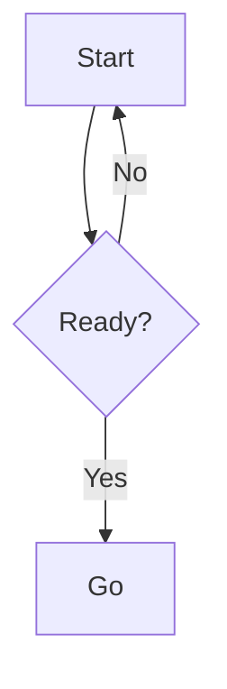

# Diagram

This skill makes software diagrams with Mermaid syntax. It covers five types: flowchart, sequence, class, ERD, and C4. It does not cover unusual types. Check mermaid.js.org for those.

## When to Use

Use this skill when the user asks to:
- diagram a process, a flow, or a decision tree
- show an API call order or a message exchange
- model classes, a domain, or an object design
- show a database schema or table relationships
- show a system architecture

Trigger words in the request: "diagram", "visualize", "model", "map out", "show the flow".

Do not use this skill when:
- the answer needs no picture
- the type is unusual (mindmap, timeline, quadrant chart, requirement diagram)

## Prerequisites

None. Mermaid renders in GitHub, GitLab, Notion, and Obsidian markdown.

Optional: the Mermaid CLI for local checks.
Install it with `npm install -g @mermaid-js/mermaid-cli`.

## Decide the Type

| The user wants | Use |
|---|---|
| process, workflow, algorithm, decision | flowchart |
| call order, message exchange, API flow | sequence |
| classes, domain model, object design | class |
| database schema, tables, relations | ERD |
| system architecture, system context | C4 |
| another type | check mermaid.js.org |

## Format

Every diagram is a fenced mermaid block. The first line declares the type. This is mandatory.



## Rules

1. First line: the diagram type. Example: `flowchart TD`, `sequenceDiagram`.
2. Node IDs: letters, digits, and underscore only. No spaces, no dashes, no dots.
3. Label with special characters: wrap it in double quotes. Example: `A["Order #1"]`.
4. Label with `(` or `{`: wrap it in double quotes.
5. Comment: start the line with `%%`.
6. Keep one idea per diagram. Max 15 nodes for a flowchart. Split larger diagrams.
7. Name each edge when the direction is not obvious.

## Procedure

1. Read the request. Identify the subject: flow, sequence, model, schema, or architecture.
   Completion: the type in the table matches the request.
2. Write the block. Use the correct type name for the first line.
   Completion: the first line matches the table.
3. Check every node ID. Apply rules 2 to 4.
   Completion: no ID breaks a rule.
4. Deliver the diagram. Put the block in the answer. Save the block as a `.mmd` file when the user asks for a file. For an image, render with mmdc (see Export).
   Completion: the block renders in markdown or the image file exists on disk.

## Verify

1. Read the diagram top to bottom. Does every edge connect two existing IDs?
2. Does every node have an edge?
3. Optional: render with the Mermaid CLI. `mmdc -i diagram.mmd -o diagram.svg` returns a non-zero exit code on syntax errors.
4. Optional: paste the code into mermaid.live. The preview shows errors.

## Export

When the user asks for an image (SVG, PNG, or JPG), use the Mermaid CLI.

Save the diagram code to a `.mmd` file. Then run:

```
mmdc -i diagram.mmd -o diagram.png
mmdc -i diagram.mmd -o diagram.svg
mmdc -i diagram.mmd -o diagram.jpg
```

For a single export without the CLI, paste the code into mermaid.live and use the export button.

The Mermaid CLI needs Node and a headless browser. Install it with `npm install -g @mermaid-js/mermaid-cli`.

## Pitfalls

- Misspelled ID: Mermaid makes a second node. It does not error. Reuse the exact ID.
- Wrong type name: the block renders nothing. `sequenceDiagram` is one word.
- `flowchart` needs a direction. Use `flowchart TD` or `flowchart LR`. The old `graph` keyword still works.
- GitHub renders a subset only. C4, `architecture-beta`, and `look: handDrawn` do not render on GitHub.
- Special characters in a label break the block or add a node. Quote the label.
- Long diagrams get tangled. Split them.

## References

Details and examples per type:
- [flowcharts.md](./flowcharts.md)
- [sequence.md](./sequence.md)
- [class-diagrams.md](./class-diagrams.md)
- [erd.md](./erd.md)
- [c4.md](./c4.md)
- [advanced.md](./advanced.md)