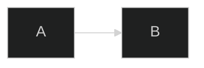
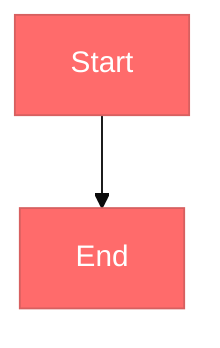

# Advanced Features

Themes, frontmatter, and the less common diagram types.

## Frontmatter

A mermaid block can start with YAML config:



## Themes

| Theme | Look |
|---|---|
| `default` | standard |
| `forest` | green tones |
| `dark` | dark background |
| `neutral` | grayscale |
| `base` | plain, for custom colors |

## Custom Colors



## Look and Layout

| Option | Values |
|---|---|
| `look` | `classic`, `handDrawn` |
| `layout` | `dagre`, `elk` |

`elk` needs extra integration. `handDrawn` does not render on GitHub.

## State Diagram

```
stateDiagram-v2
    [*] --> Idle
    Idle --> Running: start
    Running --> Paused: pause
    Paused --> Running: resume
    Running --> [*]: stop
```

## Git Graph

```
gitGraph
    commit
    branch feature
    checkout feature
    commit
    checkout main
    merge feature
```

## Gantt

```
gantt
    title Release Plan
    dateFormat YYYY-MM-DD
    section Build
        Setup    :setup, 2026-10-01, 3d
        Deploy   :deploy, after setup, 2d
```

## Pie

```
pie title Traffic Sources
    "Search" : 60
    "Direct" : 30
    "Ads" : 10
```

## Architecture Beta

`architecture-beta` ships in Mermaid 11.1. GitHub does not render it.

```
architecture-beta
    group api(cloud)[API]
    service server(server)[Server] in api
    service db(database)[Database]
    server:R --> L:db
```

## Rules

1. Add frontmatter only when the default theme is wrong.
2. `handDrawn` and `architecture-beta` do not render on GitHub. Say so to the user.
3. For types not listed here, check mermaid.js.org.